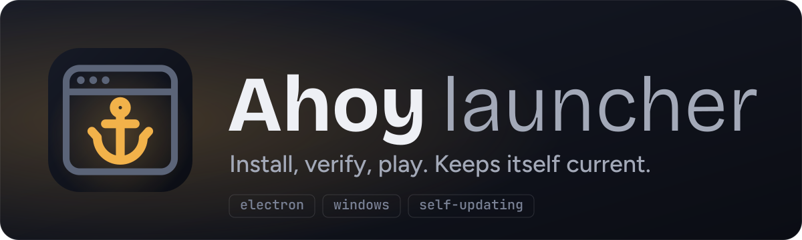

<div align="center">



<br>

**The PC client for an [Ahoy](https://github.com/robertson-dev/ahoy) server on your network.**
Shows the server's own UI, installs games onto disk, verifies every file, plays, and keeps itself up to date.

[](https://www.electronjs.org)
[](https://bun.sh)
[](tsconfig.json)
[](#-building-a-release)
[](package.json)

[What it does](#-what-it-does) · [How it works](#-how-it-works) · [Layout](#-layout) · [Development](#-development) · [Releases & updates](#-building-a-release)

</div>

---

An Electron window shows the server's web UI, so the app is always current without shipping a new build. This
process adds what a browser cannot do.

## ✨ What it does

| | |
|---|---|
| 📦 **Install** | Takes a game from the server as blocks: a few requests for the whole game however many files it has, over several streams, compressed where that helps. What is on disk already is not fetched, so an update brings only the blocks that changed and a stopped download goes on where it was. A server that cannot send blocks is asked file by file (a segmented, resumable HTTP engine), as before. A desktop shortcut while that setting is on. |
| ✅ **Verify** | Every block's sha256 is checked as it arrives and before it is written; file by file, every file's sha256 is checked against the manifest and anything wrong is fetched again once. |
| 🧰 **Prerequisites** | Runs redistributables silently before the first launch. |
| ▶️ **Play** | Launches the game the way the server says it starts now (a start the admin corrected reaches copies already installed at their next Play), and reports play sessions so friends see what you are playing. |
| 🔄 **Self-update** | Follows `<server>/launcher/latest.yml`, downloads a newer build in the background and installs it on the next restart. |
| 💾 **Saves in step** | Finds a game's saves on this PC by the server's rules (paths that start at the game's folder, Documents, AppData and the like), packs them into one file for the server after playing and puts the newest version back before playing. What a version replaces is copied to `save-backups/` first. Never a program, script or shortcut, never through a link, never outside the places a rule may name (`src/saves.ts`, `src/savesync.ts`). |
| 🔔 **Without its window** | Closed, Ahoy stays by the clock (a tray icon: Open, Quit), so what was asked for from a phone or another PC still installs here; it can start with Windows, there and not in front. A Windows notification says when a game is ready; clicking it opens the game's page. |
| 🎨 **Native feel** | Frameless window with its own title bar and themed scrollbars — the chrome belongs to the app, not the OS. |
| 📺 **Big screen** | The server's own pages on the whole display, zoomed for a television (a 1080p set shows the app as a 1280 × 720 window, half again as large) and driven by a controller. `Ahoy.exe --big` starts in it (also when Ahoy already runs). In Settings → This PC, a controller's home button (Xbox, PS) can bring Ahoy to the front, or do that and open the big screen, from inside a game too: a window that is never shown listens for it while the setting is on. Windows' own Game Bar listens to the same button; turn that off in Windows (Settings → Gaming → Game Bar) if both answer. |

## ⚙️ How it works

```mermaid
sequenceDiagram
    participant P as Server page (in the window)
    participant L as Launcher (main process)
    participant S as Ahoy server
    P->>L: setSession(token) after sign-in
    L->>S: GET /api/v1/package/:id  (Authorization: Bearer)
    S-->>L: manifest
    L->>S: GET /api/v1/package/:id/blocks, then POST …/blocks {digest, want}  (a few requests, several at once)
    S-->>L: the blocks asked for, each checked against its sha256 as it arrives
    Note over L,S: a server without blocks: GET /api/v1/package/:id/files/* (Range), then sha256 every file
    L->>L: run prerequisites · shortcut
    P->>L: play(slug)
    L->>S: GET /api/v1/package/:id/launch  (at Play, at most 3 s)
    S-->>L: {launch, rev, requires, kind}, or 404 once the package was replaced
    L->>L: start the game (a program directly; a game's own .bat or .cmd by its path in a variable)
    L->>P: installed / playing → shown to friends
```

- The **page signs the person in** and hands the launcher the session token. The launcher never sees a password and carries no API key.
- The **server streams package files through** from the engine, so the engine's key never reaches a PC.
- The launcher **carries no server address of its own**: the first run asks for one, and nothing else is tied to a particular server.
- **Installing by itself** is the page's doing (0.13.0 adds what it needs: `disk`, `notify`, the settings `background` and
  `startWithWindows`): the server keeps "install this game on that PC" orders, and the page running in that PC's launcher
  carries them out with the launcher's own Install, one at a time, saying how far it is.
- **Saves** (0.13.0, feature `saves`, setting `syncSaves`): the page says which game, where it keeps its saves and what to
  do; the launcher looks (`state`), brings this PC's saves to the server (`push`), puts a version back (`pull`) or notes
  that both already agree (`agree`). A save is named by its place and its path under it, so it is the same file on a PC
  where Documents is somewhere else; the digest two PCs agree by is taken over names, sizes and contents. Nothing is put
  back under a game that runs, and nothing changes on this PC unless every file of a version checked out first.
- **How a game starts can change after it is installed** (0.11.0, feature `launch-refresh`). Play asks the server how the
  package starts now and takes a changed start when an install would: a program the launcher installed for that package,
  inside the game's folder, needing no newer launcher. The game's record and the launcher's own desktop shortcut follow (the
  shortcut is removed while the setting is off). Offline, signed out, no answer within 3 s, a 404 (the package was
  replaced: that is an Update) or a start it must not follow: Play starts the recorded start, as before.
- A changed start Play does not take is noted on the game's record, and the page then offers **Update** for it. So does a
  game recorded under another server address (Play asks only the server it uses now) and every game on a launcher before
  0.11. That Update installs the same package again: nothing is downloaded, but every file is checked again and the
  package's setup programs (prerequisites) run again.
- **A game can start through its own script** (0.11.0, feature `script-start`, Windows): a `.bat` or `.cmd` of the game,
  for one that needs it (it loads a driver first, asks for administrator rights, starts two programs). Windows runs a
  script through its command shell, which reads a command line as commands, so the shell is handed nothing it could read
  that way: the script's path goes to it in a variable (`AHOY_START`, expanded once, inside quotes) and the script's
  arguments are plain words only (letters, digits and `. _ - + = , : / \ @`). A package whose script is handed anything
  else is not installed, and never started. The script itself does what it says, with the player's rights. When it hands
  the game on and ends (one that asks for administrator rights starts itself again and exits), the game counts as running
  for as long as a program holds one of the game's programs.

## 📁 Layout

```
src/main.ts        Electron main: window, config, server probe, the session the page hands over, IPC, shortcuts
src/updater.ts     self-update: follows <server>/launcher/latest.yml, downloads in the background, installs on restart
src/preload.ts     the bridge the web UI sees as window.ahoyLauncher
src/pad.ts         the page side of the pad watcher (a window that is never shown): tells the main process when a controller's home button is pressed
src/pad-edge.ts    what one press of that button is (no imports: the watcher is a sandboxed preload)
src/guard.ts       what the main process checks before it trusts a page, a link, a settings change or an update feed
src/engine.ts      install / verify / prerequisites / play / uninstall (plain Node; tested with bun test)
src/pull/          blocks.ts: a game as blocks (the index, what is on disk already, the streams); pull-http.ts: file by file, segmented and resumable
assets/setup.html  first run: the server address and the install folder; signing in happens on the server's page
build.ts           bundles main/preload/updater into dist/ (electron-updater is bundled in, never external)
tests/             the engine against a fake server (Range-served, session-checked files); e2e against a real one
```

## 🛠️ Development

```sh
bun install
bun run build        # dist/main.cjs + dist/preload.cjs + dist/updater.cjs
bun test             # the engine against a fake server
bun run test:update  # the self-updater against a local feed (and what it must refuse)
bun run smoke        # the real main process against local stand-in servers: hidden, no account, nothing installed

# the real app against a real server
SERVER=http://<ahoy server>:8790 AHOY_USER=… AHOY_PASS=… GAME=7 bun run e2e
```

## 🚀 Building a release

```sh
bun run dist         # release/Ahoy-Setup-<version>.exe + latest.yml + .blockmap
```

That is a one-click NSIS installer plus the update feed. Publishing it is the server's job: Ahoy's `deploy/unraid.py`
(or anyone copying `release/` into the server's `<config>/launcher/`) puts the installer and `latest.yml` where
connected launchers look. Each launcher checks shortly after connecting and every few hours (or on *Settings → This PC
→ Check now*), downloads in the background and installs on the next restart.

> **Note** · Builds older than 0.7.0 have no updater; those PCs install the next build by hand once.

> **0.11.0** · Play takes a start the server changed in place (see *How it works*). Until a PC runs 0.11, the page offers
> its games whose start changed an Update, which checks every file and runs the package's setup programs again. A game
> that starts through its own script needs 0.11: an older launcher is told so before it downloads anything.

## 🎨 Brand

`brand/icon.svg` is the mark (also the web favicon) and `brand/banner.svg` the header above, both plain SVG with the
type outlined, so they render anywhere. Palette: navy `#0b0d14` with the lamp amber `#f2b24a`;
type: Bricolage Grotesque for the wordmark, Figtree for text, JetBrains Mono for the chips.

<p> &nbsp;  &nbsp; </p>

---

<div align="center"><sub>Part of <a href="https://github.com/robertson-dev/ahoy">Ahoy</a> · engine: <a href="https://github.com/robertson-dev/ludarr">Ludarr</a></sub></div>
